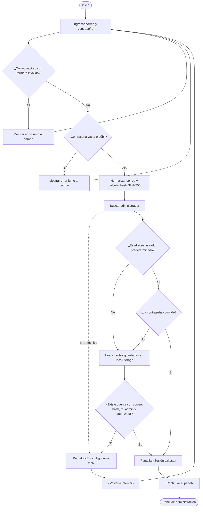
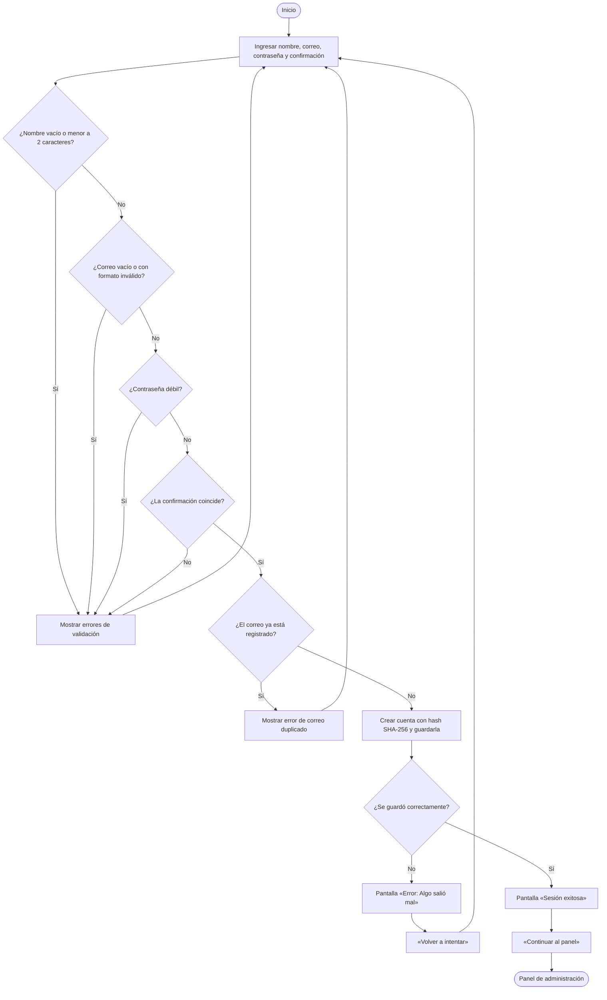

# Actividades: inicio de sesión y creación de cuenta

Documentación del flujo de autenticación de Hestia. Se basa en el código de
[`src/page/login.jsx`](../src/page/login.jsx) y en el cambio de sesión de
[`src/App.jsx`](../src/App.jsx).

- **Módulo:** autenticación de administradores
- **Pantalla:** inicio de sesión / creación de cuenta
- **Entrada al panel:** tras confirmar la pantalla de sesión exitosa

## 1. Objetivo

Describir las actividades, decisiones y validaciones que realiza el sistema desde que el
administrador abre la aplicación hasta que entra al panel, incluyendo el registro de una
cuenta nueva y los casos de error.

## 2. Alcance

Incluye:

- Inicio de sesión con correo y contraseña.
- Validación de formato de correo y política de contraseña.
- Autenticación contra el administrador predeterminado y las cuentas guardadas.
- Pantalla intermedia de **«Sesión exitosa»** con el botón **«Continuar al panel»**.
- Pantalla de **«Error: Algo salió mal»** ante credenciales inválidas o fallos técnicos.
- Creación de una cuenta de administrador y autenticación automática.

No incluye recuperación de contraseña, autenticación de dos factores ni integración con un
backend.

## 3. Actores

| Actor | Rol |
| --- | --- |
| Administrador | Ingresa sus credenciales o crea una cuenta. |
| Sistema (frontend) | Valida datos, calcula el hash, autentica y muestra las pantallas de resultado. |

## 4. Precondiciones y postcondiciones

| Momento | Condición |
| --- | --- |
| Precondición | La aplicación está abierta y no existe una sesión activa. |
| Postcondición de éxito | Se muestra «Sesión exitosa»; al continuar, `App` renderiza el panel de administración con la sesión del administrador. |
| Postcondición de error | Se muestra «Error: Algo salió mal»; al reintentar, se vuelve al formulario correspondiente. |
| Postcondición de registro | La cuenta queda guardada en `localStorage` y se muestra la pantalla de sesión exitosa. |

## 5. Flujo de inicio de sesión

1. El administrador abre la aplicación; `App` no tiene sesión y renderiza `Login`.
2. El administrador ingresa correo y contraseña. Puede mostrar u ocultar la contraseña.
3. Al enviar el formulario, el sistema valida:
   - correo obligatorio y con formato válido;
   - contraseña obligatoria y con la política de seguridad.
4. Si hay errores, se muestran junto a cada campo y el flujo vuelve al paso 2.
5. Si los datos son válidos, se normaliza el correo (`trim` + minúsculas) y se calcula el
   hash SHA-256 de la contraseña.
6. Se busca al administrador:
   - primero se compara con el administrador predeterminado;
   - si no coincide, se buscan las cuentas guardadas que tengan el mismo correo, hash,
     rol `admin` y estén autorizadas.
7. Si no se encuentra una cuenta válida, se muestra la pantalla de error con el mensaje
   «El correo o la contraseña no son correctos…».
8. Si se encuentra, se muestra la pantalla **«Sesión exitosa»** con el nombre y correo del
   administrador.
9. El administrador pulsa **«Continuar al panel»** y `App` reemplaza el login por el panel.

### 5.1 Credenciales inválidas

- La autenticación devuelve `null`.
- Se muestra la pantalla **«Error: Algo salió mal»**.
- El botón **«Volver a intentar»** regresa al formulario de inicio de sesión con los
  errores limpios.

### 5.2 Error técnico

- Si la autenticación lanza una excepción, se muestra la misma pantalla de error con el
  mensaje «No pudimos validar tus credenciales. Inténtalo de nuevo.».
- El botón **«Volver a intentar»** regresa al formulario.

### 5.3 Sesión exitosa

- La pantalla muestra «Sesión exitosa», el nombre del administrador y su correo.
- La sesión todavía no se abre hasta pulsar **«Continuar al panel»**.
- Al continuar, `App` guarda la sesión en memoria y muestra el panel.

## 6. Flujo de creación de cuenta

1. Desde el login, el administrador pulsa **«Crear cuenta»**.
2. Ingresa nombre completo, correo, contraseña y confirmación.
3. Al enviar, el sistema valida:
   - nombre obligatorio y de al menos 2 caracteres después de quitar espacios;
   - correo obligatorio y con formato válido;
   - contraseña con la política de seguridad;
   - confirmación obligatoria e igual a la contraseña.
4. Si hay errores, se muestran junto a los campos y el flujo vuelve al paso 2.
5. Si los datos son válidos, se normaliza el correo y se comprueba que no exista, ni en el
   administrador predeterminado ni en las cuentas guardadas.
6. Si el correo ya existe, se muestra el error «Ya existe una cuenta con este correo
   electrónico.».
7. Si no existe, se crea la cuenta con rol `admin`, `authorized: true`, hash SHA-256 y fecha
   de creación, y se guarda en `localStorage`.
8. Si el guardado falla, se muestra la pantalla **«Error: Algo salió mal»**.
9. Si el guardado funciona, la cuenta queda autenticada y se muestra **«Sesión exitosa»**.
10. Al pulsar **«Continuar al panel»**, se abre el panel con la cuenta recién creada.

## 7. Reglas de validación

| Campo | Regla | Mensaje |
| --- | --- | --- |
| Correo (login) | Obligatorio | Ingresa tu correo electrónico. |
| Correo (login y registro) | Formato `usuario@dominio.algo` | Ingresa un correo electrónico válido. |
| Contraseña (login) | Obligatoria | Ingresa tu contraseña. |
| Contraseña (login y registro) | Mínimo 12 caracteres, una mayúscula, una minúscula, un número y un símbolo | 12 caracteres / letras mayúsculas, minúsculas, números y símbolos |
| Nombre (registro) | Obligatorio, mínimo 2 caracteres sin espacios extremos | Ingresa tu nombre. / El nombre debe tener al menos 2 caracteres. |
| Contraseña (registro) | Obligatoria y con la política de seguridad | Crea una contraseña. / La contraseña debe cumplir todos los requisitos. |
| Confirmación (registro) | Obligatoria e igual a la contraseña | Confirma tu contraseña. / Las contraseñas no coinciden. |
| Correo (registro) | No debe existir otra cuenta con ese correo | Ya existe una cuenta con este correo electrónico. |

## 8. Mensajes y pantallas de resultado

| Situación | Título | Descripción / acción |
| --- | --- | --- |
| Credenciales válidas | Sesión exitosa | «Bienvenido, {nombre}. Sesión iniciada como {correo}.» · **Continuar al panel** |
| Credenciales inválidas | Error: Algo salió mal | «El correo o la contraseña no son correctos. Verifica tus datos e inténtalo de nuevo.» · **Volver a intentar** |
| Fallo técnico al autenticar | Error: Algo salió mal | «No pudimos validar tus credenciales. Inténtalo de nuevo.» · **Volver a intentar** |
| Fallo al crear la cuenta | Error: Algo salió mal | «No pudimos crear tu cuenta. Inténtalo de nuevo.» · **Volver a intentar** |

## 9. Diagramas de actividades

Inicio de sesión y creación de cuenta son actividades independientes: cada una tiene su
propio inicio, sus validaciones y su desenlace. La creación de cuenta no forma parte del
flujo de inicio de sesión; solo comparte con él las pantallas de resultado.

### 9.1 Inicio de sesión

### 9.2 Creación de cuenta

## 10. Persistencia y seguridad (demostración)

- **Hash:** SHA-256 calculado con Web Crypto sobre `hestia:{contraseña}` y representado en
  hexadecimal. Es una medida de demostración: el prefijo es fijo y público, por lo que no
  sustituye a un hash con sal aleatoria y costo configurable en un backend real.
- **Cuentas guardadas:** arreglo JSON en `localStorage` con la clave `hestia_admins_v1`.
- **Administrador predeterminado:** `admin@hestia.com` / `Admin123!2026`, definido en el
  código y disponible aunque `localStorage` esté vacío.
- **Sesión:** se guarda únicamente en el estado de React (`App`). Al recargar la página se
  pierde la sesión y se vuelve al login.
- **Correo:** se normaliza con `trim` y minúsculas antes de comparar o guardar.
- **Autorización:** solo se autentican cuentas con rol `admin` y `authorized: true`.
- **Limitaciones:** no hay backend, recuperación de contraseña, límite de intentos,
  verificación de correo ni cierre de sesión por inactividad.

## 11. Criterios cubiertos

- [x] Mostrar la pantalla **«Sesión exitosa»** con el botón **«Continuar al panel»** antes
      de abrir el panel.
- [x] Mostrar la pantalla **«Error: Algo salió mal»** cuando las credenciales no son
      válidas.
- [x] Permitir reintentar el inicio de sesión desde la pantalla de error.
- [x] Validar correo y contraseña antes de autenticar.
- [x] Permitir crear una cuenta de administrador y autenticarla automáticamente.
- [x] Mantener las cuentas creadas en `localStorage`.

## 12. Cómo probar

1. Ejecutar `npm run dev` y abrir la URL que indica Vite.
2. Credenciales de demostración: `admin@hestia.com` / `Admin123!2026`.
3. Con credenciales correctas se muestra «Sesión exitosa»; pulsar «Continuar al panel».
4. Con una contraseña incorrecta se muestra «Error: Algo salió mal»; pulsar «Volver a
   intentar» y verificar que se regresa al formulario.
5. Probar «Crear cuenta» con una contraseña que no cumpla la política para ver los
   requisitos en vivo, y luego con una válida para confirmar el registro.

## 13. Observaciones

- El formulario de inicio de sesión aplica la misma política de contraseña que el registro;
  una cuenta con contraseña débil no podría iniciar sesión desde esta pantalla.
- La creación de cuenta autentica al administrador de inmediato, sin un paso separado de
  inicio de sesión.
- La especificación de US-1 no se encuentra en el repositorio; este documento se basa en
  el comportamiento implementado y en los criterios de login conocidos. Si US-1 define
  criterios adicionales, conviene contrastarlos con este flujo.
